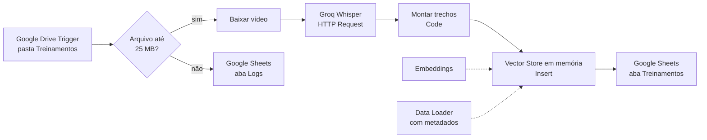
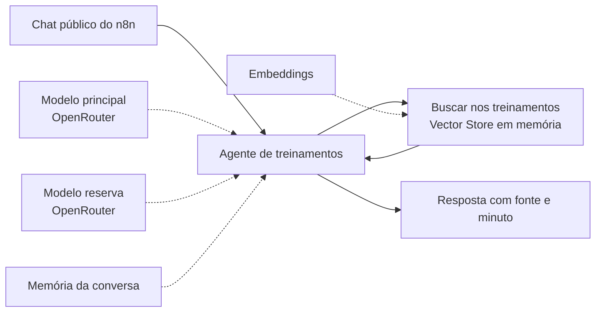

# RAG de treinamentos de ferramentas com IA Generativa

Fluxo end-to-end em n8n: vídeo de treinamento no Google Drive, transcrição com Groq Whisper, índice vetorial com embeddings e chat que responde com citação do treinamento e do minuto.

Arquivos do projeto:

| Arquivo | Conteúdo |
|---|---|
| [workflow-rag-ingestao.json](workflow-rag-ingestao.json) | Workflow que transforma o vídeo em base consultável |
| [workflow-rag-consulta.json](workflow-rag-consulta.json) | Workflow do chat com o agente |
| [prompts/rag-system.md](prompts/rag-system.md) | Prompt do agente, descrição da ferramenta e parâmetros |
| [roteiro-demo.md](roteiro-demo.md) | Roteiro do vídeo de 3 a 5 minutos e lista de prints |
| [workflow-ata-reunioes.json](workflow-ata-reunioes.json) | Fluxo anterior de resumo de ata (ver anexo) |

## 1. Descrição do problema

A empresa tem muitos treinamentos de ferramentas. Sempre que entra um colaborador novo, ou quando há reciclagem, o treinamento precisa ser repetido por quem o conhece. Os vídeos existem, mas ninguém assiste a um vídeo inteiro para achar um passo específico, e a dúvida acaba indo para uma pessoa.

A solução transforma cada vídeo em uma base consultável. O colaborador pergunta no chat, por exemplo "como faço o teste do ATENTO com segurança?", e recebe os passos baseados no vídeo, com o nome do treinamento e o minuto onde o assunto aparece.

## 2. Engenharia de prompts

Texto completo em [prompts/rag-system.md](prompts/rag-system.md).

### 2.1 Instruções do sistema (agente de consulta)

```
Você é o assistente de treinamentos da empresa. Responda em português do Brasil, de forma objetiva.

Regras:
1. Antes de responder, sempre use a ferramenta "Buscar nos treinamentos".
2. Responda somente com base nos trechos recuperados. Não use conhecimento externo e não invente passos, telas, botões ou configurações.
3. Se os trechos não trouxerem a resposta, diga exatamente: "Não encontrei isso nos treinamentos gravados." e sugira procurar o responsável pela ferramenta.
4. Quando a pergunta for sobre um procedimento, responda em passos numerados.
5. Ao final, cite a fonte no formato: Fonte: <treinamento>, minuto <minuto>. Se houver mais de um trecho, liste cada um. Inclua o link do vídeo quando existir nos metadados.
6. Se a pergunta for ambígua e houver treinamentos de ferramentas diferentes nos trechos, pergunte qual ferramenta o usuário quer antes de responder.
```

Decisões de projeto:

- A regra 2 e a regra 3 limitam o agente ao conteúdo gravado, para ele não responder com conhecimento genérico sobre a ferramenta.
- A regra 5 depende dos metadados gravados na ingestão (treinamento, minuto, link), o que permite conferir a resposta no vídeo.
- A regra 6 evita misturar treinamentos de ferramentas diferentes.

### 2.2 Descrição da ferramenta de busca

O agente decide quando buscar com base no texto abaixo, que faz parte do prompt:

```
Busca trechos de treinamentos de ferramentas gravados em vídeo. Use sempre antes de responder qualquer pergunta sobre como usar uma ferramenta, processo ou procedimento. Cada trecho traz treinamento, ferramenta e minuto nos metadados.
```

### 2.3 Dados e metadados de cada trecho

| Campo | Origem |
|---|---|
| texto | Fala transcrita, agrupada em trechos de cerca de 800 caracteres |
| treinamento | Nome do arquivo sem extensão |
| ferramenta | Parte do nome antes de " - " ou "_" (convenção `Ferramenta - Assunto.mp4`) |
| minuto | Início do trecho no vídeo, formato m:ss |
| arquivo e link | Nome e link do arquivo no Drive |

### 2.4 Parâmetros

| Item | Valor |
|---|---|
| Transcrição | Groq `whisper-large-v3-turbo`, idioma `pt`, `verbose_json` (traz segmentos com tempo) |
| Embeddings | `text-embedding-3-small` |
| Busca | topK 4, com metadados |
| Modelo do chat | `google/gemma-4-31b-it:free` (OpenRouter), temperature 0.2 |
| Modelo reserva | `nvidia/nemotron-3-ultra-550b-a55b:free`, usado se o principal falhar ou atingir o limite |
| Memória | Últimas 5 interações da conversa |

### 2.5 Exemplo

Pergunta: "Como faço o teste do ATENTO com segurança?"

Resposta esperada: passos numerados com o que foi dito no vídeo (usar um CPF de teste, acessar o teste, escolher o teste), seguidos de "Fonte: ATENTO - ..., minuto 0:00".

Pergunta fora do conteúdo: "Como configuro o Power BI?" retorna "Não encontrei isso nos treinamentos gravados."

## 3. Arquitetura da solução

### 3.1 Ingestão



| Nó | Função |
|---|---|
| Novo vídeo na pasta Treinamentos | Verifica a pasta a cada minuto e dispara para cada arquivo novo |
| Arquivo até 25 MB? | Bloqueia arquivos acima do limite do Whisper gratuito |
| Baixar vídeo | Baixa o arquivo do Drive |
| Transcrever (Groq Whisper) | Envia o arquivo e recebe texto e segmentos com tempo |
| Montar trechos | Falha se a transcrição estiver vazia; agrupa segmentos em trechos de cerca de 800 caracteres e guarda o minuto de início, a ferramenta e o link |
| Indexar no vector store | Gera embeddings de cada trecho e grava no índice `treinamentos` junto com os metadados |
| Registrar treinamento no Sheets | Uma linha por treinamento: Data, Arquivo, Ferramenta, Trechos, Link |
| Registrar arquivo grande no Logs | Registra o arquivo recusado e o motivo |

### 3.2 Consulta



O índice é compartilhado entre os dois workflows pela chave `treinamentos`.

### 3.3 Escolhas

| Decisão | Motivo |
|---|---|
| Groq Whisper | Gratuito e rápido, aceita português |
| Chunking por tempo no nó Code | O minuto de cada trecho é preservado e citado na resposta |
| Vector store em memória | Sem serviço extra; suficiente para a demonstração |
| Modelo reserva no agente | Modelos gratuitos têm limite de uso e a resposta não pode parar por isso |
| Chat do n8n | Link compartilhável sem desenvolver interface |

## 4. Configuração

1. Importar os dois JSONs no n8n.
2. Criar as credenciais: Google Drive, Google Sheets, Bearer do Groq (nó "Transcrever") e OpenRouter (nós de modelo). Os embeddings usam a credencial de créditos do n8n ou uma credencial OpenAI.
3. Substituir `ID_DA_PASTA_TREINAMENTOS` e `ID_DA_PLANILHA`.
4. Na planilha, criar a aba `Treinamentos` (Data, Arquivo, Ferramenta, Trechos, Link) e a aba `Logs` (Data, Fluxo, No, Erro).
5. Publicar os dois workflows. O link do chat aparece no nó "Chat de treinamentos".
6. Nomear os vídeos como `Ferramenta - Assunto.mp4`.

## 5. Teste

1. Subir na pasta Treinamentos um vídeo de até 25 MB (teste usado: vídeo de 258 s sobre o teste do ATENTO).
2. Conferir a execução da ingestão em verde, os trechos indexados e a linha na aba Treinamentos.
3. No chat, perguntar sobre o conteúdo do vídeo e conferir passos, fonte e minuto.
4. Perguntar algo fora do conteúdo e conferir a resposta "Não encontrei isso nos treinamentos gravados."
5. Subir um arquivo acima de 25 MB e conferir a linha na aba Logs.

Roteiro de captura em [roteiro-demo.md](roteiro-demo.md).

## 6. Limitações

- O vídeo entra por upload na pasta do Drive. A leitura automática das gravações do Teams exigiria a Microsoft Graph API, que depende de aprovação do TI.
- O Whisper gratuito aceita 25 MB por arquivo. O n8n Cloud não tem ffmpeg, então vídeos longos precisam ser exportados só como áudio ou comprimidos antes do upload.
- O índice em memória é perdido quando o n8n reinicia, e os vídeos precisam ser enviados de novo. Para uso contínuo, trocar por um banco vetorial persistente (Supabase pgvector, Qdrant ou Pinecone), alterando só os dois nós de vector store.
- Modelos gratuitos têm limite de requisições; o modelo reserva reduz o problema, mas não o elimina.
- A transcrição não identifica quem fala e depende da qualidade do áudio; o conteúdo só mostrado na tela e não falado não entra na base.
- O conteúdo dos treinamentos é enviado ao Groq e ao OpenRouter. Confirmar a política da empresa antes de indexar material interno.

## Anexo. Fluxo de resumo de ata

O primeiro fluxo do projeto continua no arquivo [workflow-ata-reunioes.json](workflow-ata-reunioes.json): um arquivo de ata na pasta Atas do Drive é lido por um LLM (OpenRouter, com fallback entre modelos), que gera resumo, decisões e tarefas com responsável, envia por e-mail e registra as tarefas no Sheets. Prompt em [prompts/system.md](prompts/system.md). Foi mantido como segundo workflow e não faz parte da demonstração do RAG. O ramo que lê transcrições do Teams pela Microsoft Graph está desativado, porque não há credencial aprovada.
